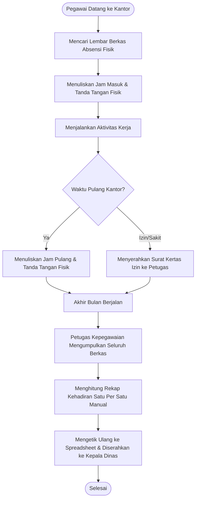
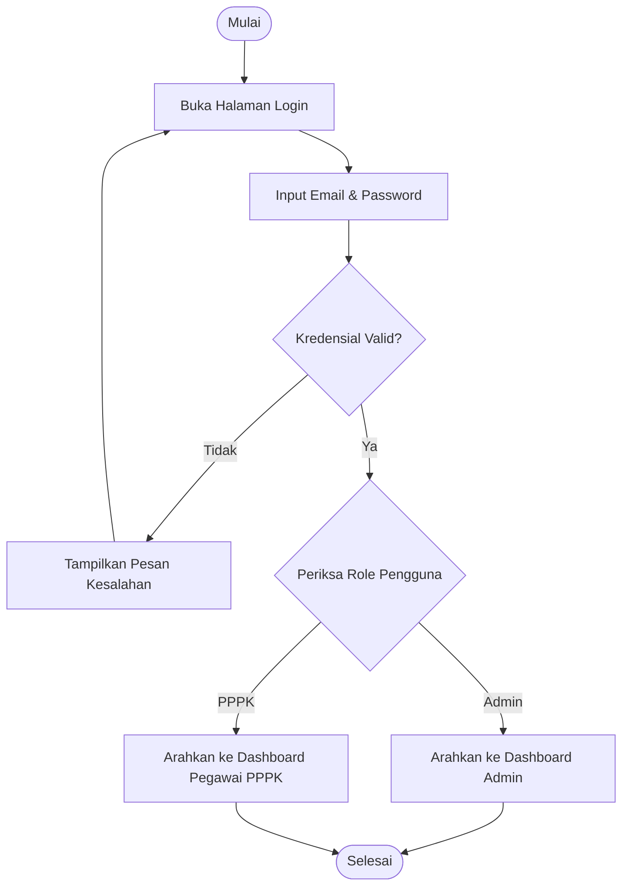
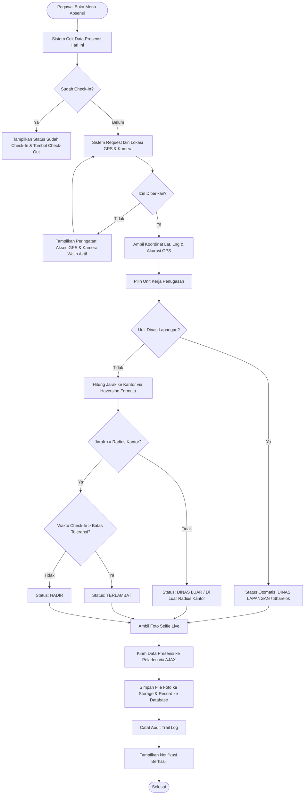
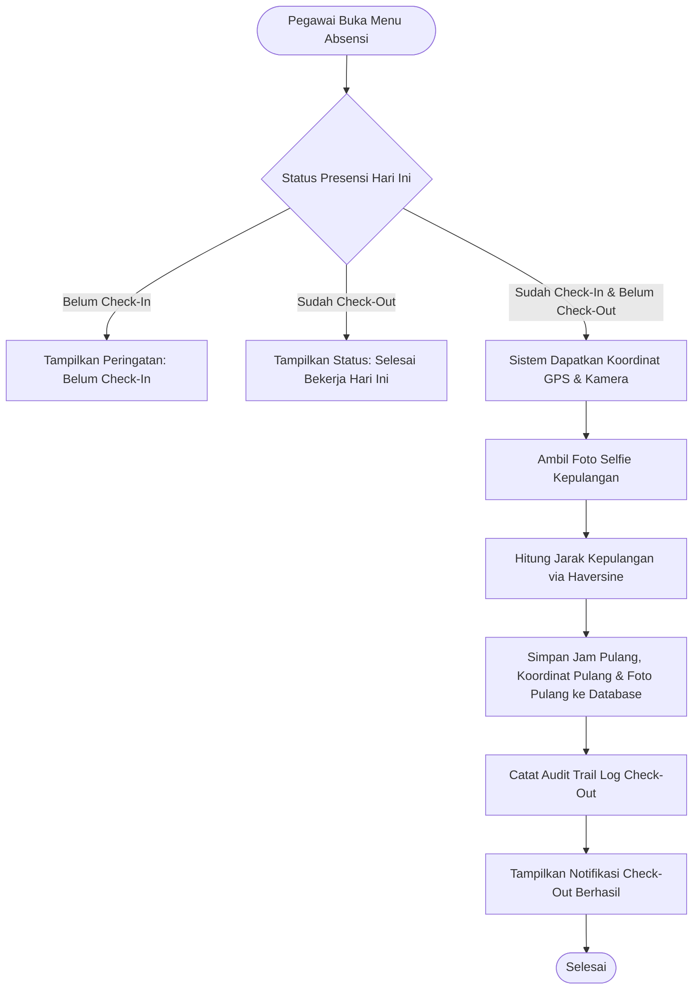
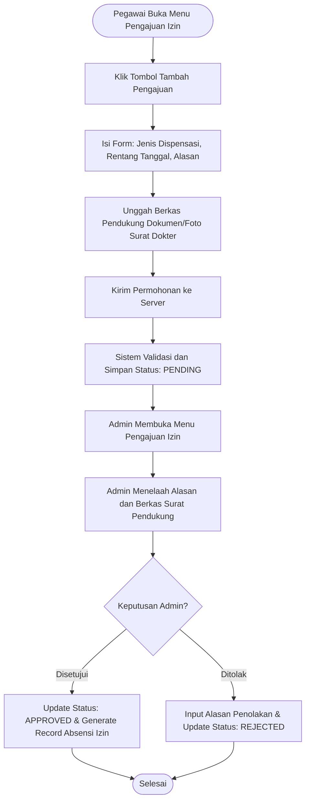
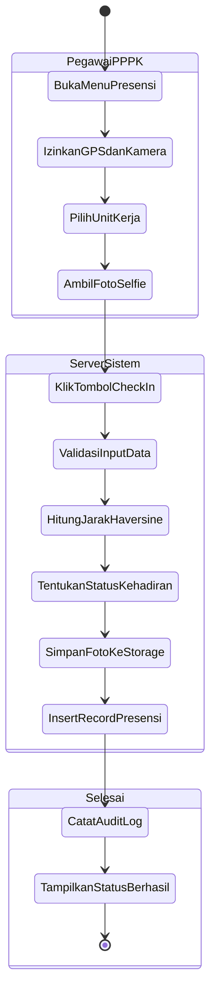
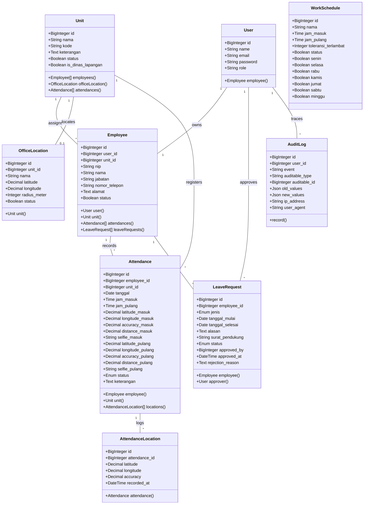

# LAPORAN MAGANG/KERJA PRAKTIK
# KURIKULUM MERDEKA BELAJAR – KAMPUS MERDEKA

## SISTEM INFORMASI ABSENSI PEGAWAI P3K PADA DINAS KEARSIPAN DAN PERPUSTAKAAN DAERAH KABUPATEN SUBANG

Diajukan untuk Memenuhi Persyaratan Program Magang/Praktik Kerja

**OLEH:**  
**Nama:** Tegar Bumi Ramadhan  
**NIM:** D1A230099  

**PROGRAM STUDI SISTEM INFORMASI**  
**FAKULTAS ILMU KOMPUTER**  
**UNIVERSITAS SUBANG**  
**2026**

---

## LEMBAR PENGESAHAN LAPORAN AKHIR

Judul: Sistem Informasi Absensi Pegawai P3K Pada Dinas Kearsipan dan Perpustakaan Daerah Kabupaten Subang  
Nama Mahasiswa: Tegar Bumi Ramadhan  
Nomor Induk Mahasiswa (NIM): D1A230099  
Program Studi: Sistem Informasi  
Fakultas: Ilmu Komputer  
Mitra Magang: Dinas Kearsipan dan Perpustakaan Kabupaten Subang (DISARPUS Kab. Subang)  
Periode Magang: 14 September 2026 s.d. 09 Januari 2027  
Tempat dan Tanggal Pengesahan: Subang, 09 Januari 2027  

Menyetujui dan Mengesahkan:

| Pembimbing Lapangan | Dosen Pembimbing |
| :---: | :---: |
| <br><br><br><u>**Pak Henri Radian**</u><br>NIP. [ISI MANUAL: NIP Pembimbing Lapangan] | <br><br><br><u>**Rakhmayudhi, M.Kom.**</u><br>NIP/NIK. [ISI MANUAL: NIP/NIK Dosen Pembimbing] |

Mengetahui,  
Ketua Program Studi Sistem Informasi  
Fakultas Ilmu Komputer Universitas Subang  

<br><br><br>
<u>**Bagus Ali Akbar, S.Si., M.Kom.**</u>  
NIK/NIP. [ISI MANUAL: NIP/NIK Ketua Program Studi]

---

## KATA PENGANTAR

Puji dan syukur penulis panjatkan ke hadirat Allah SWT, Tuhan Yang Maha Esa, karena atas berkat rahmat, karunia, dan hidayah-Nya, penulis dapat menyelesaikan seluruh rangkaian kegiatan Magang Merdeka Belajar Kampus Merdeka (MBKM) beserta penyusunan Laporan Akhir Magang ini dengan judul **"Sistem Informasi Absensi Pegawai P3K Pada Dinas Kearsipan dan Perpustakaan Daerah Kabupaten Subang"**.

Penyusunan laporan magang ini ditujukan untuk memenuhi salah satu persyaratan akademik kelulusan Program Magang/Praktik Kerja pada Program Studi Sistem Informasi, Fakultas Ilmu Komputer, Universitas Subang. Melalui program magang ini, penulis mendapatkan kesempatan berharga untuk menerapkan ilmu pengetahuan teknologi informasi yang diperoleh di bangku perkuliahan secara nyata, khususnya dalam menganalisis permasalahan administrasi kepegawaian dan merancang solusi perangkat lunak yang relevan bagi instansi pemerintah daerah.

Keberhasilan pelaksanaan magang dan penyusunan laporan ini tidak lepas dari bimbingan, arahan, dukungan, serta bantuan dari berbagai pihak. Oleh karena itu, dengan penuh kerendahan hati, penulis menyampaikan rasa terima kasih dan penghargaan yang setinggi-tingginya kepada:
1. Bapak Rektor Universitas Subang beserta jajaran pimpinan universitas yang telah memfasilitasi program Merdeka Belajar Kampus Merdeka.
2. Bapak Dekan Fakultas Ilmu Komputer Universitas Subang beserta jajaran struktural fakultas atas dukungan akademik yang diberikan.
3. Bapak Bagus Ali Akbar, S.Si., M.Kom., selaku Ketua Program Studi Sistem Informasi Fakultas Ilmu Komputer Universitas Subang.
4. Bapak Rakhmayudhi, M.Kom., selaku Dosen Pembimbing Magang yang senantiasa meluangkan waktu memberikan bimbingan, arahan, masukan, dan motivasi yang sangat berarti bagi penulis selama proses magang dan penulisan laporan.
5. Pimpinan Dinas Kearsipan dan Perpustakaan Kabupaten Subang ([ISI MANUAL: Nama dan Jabatan Pimpinan Tertinggi DISARPUS Subang]) yang telah memberikan izin dan menyambut hangat penulis untuk melaksanakan program magang di instansi.
6. Bapak Henri Radian, selaku Pembimbing Lapangan di Dinas Kearsipan dan Perpustakaan Kabupaten Subang, yang telah memberikan bimbingan, pendampingan, arahan kerja teknis, serta wawasan profesional selama kegiatan magang berlangsung.
7. Bapak Agus Supriadi, S.AP., M.M., yang telah memberikan masukan mendalam, diskusi kebutuhan sistem, serta arahan fungsional terkait kebutuhan presensi pegawai.
8. Seluruh staf dan pegawai di lingkungan Dinas Kearsipan dan Perpustakaan Kabupaten Subang, khususnya pada Bagian Pengawasan dan Arsip, atas keramahan, kerja sama, dan bantuan data selama penulis menjalankan tugas magang.
9. Orang tua dan keluarga tercinta atas doa, motivasi, pengorbanan, dan dukungan moril maupun materil yang tiada henti.
10. Rekan-rekan mahasiswa Program Studi Sistem Informasi angkatan 2023 dan semua pihak yang tidak dapat penulis sebutkan satu persatu atas kebersamaan dan bantuan yang telah diberikan.

Penulis menyadari bahwa dalam penyusunan laporan magang ini masih terdapat kekurangan dan keterbatasan. Oleh karena itu, penulis sangat mengharapkan kritik dan saran yang membangun dari pembaca demi perbaikan dan penyempurnaan di masa yang akan datang. Semoga laporan ini dapat memberikan manfaat nyata bagi instansi mitra, civitas akademika Universitas Subang, serta pihak-pihat lain yang memerlukan.

Subang, 09 Januari 2027  
Penulis,  

**Tegar Bumi Ramadhan**  
NIM. D1A230099

---

## DAFTAR ISI

- LEMBAR PENGESAHAN LAPORAN AKHIR
- KATA PENGANTAR
- DAFTAR ISI
- DAFTAR GAMBAR
- DAFTAR TABEL
- DAFTAR LAMPIRAN
- BAB I PENDAHULUAN
  - 1.1 Latar Belakang
  - 1.2 Rumusan Masalah
  - 1.3 Batasan Masalah
  - 1.4 Tujuan Magang
  - 1.5 Manfaat Magang
- BAB II INSTANSI DAN AKTIVITAS MAGANG
  - 2.1 Profil Instansi
    - 2.1.1 Gambaran Umum Instansi
    - 2.1.2 Visi dan Misi Instansi
    - 2.1.3 Struktur Organisasi
    - 2.1.4 Lokasi dan Lingkungan Tempat Magang
  - 2.2 Deskripsi Aktivitas Magang
  - 2.3 Jadwal Pelaksanaan Magang
- BAB III LANDASAN TEORI
  - 3.1 Sistem Informasi
  - 3.2 Presensi Pegawai dan Manajemen Kehadiran
  - 3.3 Geolocation dan Algoritma Haversine Formula
  - 3.4 Kerangka Kerja Laravel dan Bahasa Pemrograman PHP
  - 3.5 Basis Data Relasional MySQL dan Object-Relational Mapping (ORM)
  - 3.6 Unified Modeling Language (UML) dan Pemodelan Sistem
  - 3.7 Black Box Testing
- BAB IV PELAKSANAAN DAN PRODUK MAGANG
  - 4.1 Proses Pelaksanaan Magang
  - 4.2 Metode Pengumpulan Data
  - 4.3 Analisis Sistem yang Berjalan di Tempat Magang
  - 4.4 Analisis dan Desain Sistem yang Dihasilkan
    - 4.4.1 Analisis Kebutuhan Fungsional
    - 4.4.2 Analisis Kebutuhan Non Fungsional
    - 4.4.3 Flowchart Sistem
    - 4.4.4 Pemodelan UML (Use Case, Activity, dan Class Diagram)
    - 4.4.5 Rancangan Basis Data
    - 4.4.6 Desain Antarmuka Sistem
  - 4.5 Implementasi Sistem
    - 4.5.1 Implementasi Basis Data
    - 4.5.2 Implementasi Pemrograman
    - 4.5.3 Implementasi Antarmuka Sistem
- BAB V PENUTUP
  - 5.1 Simpulan
  - 5.2 Saran
- DAFTAR PUSTAKA
- LAMPIRAN

---

## DAFTAR GAMBAR

- Gambar 2.1 Lokasi Tempat Instansi
- Gambar 2.2 Struktur Organisasi Dinas Kearsipan dan Perpustakaan Kabupaten Subang
- Gambar 4.1 Flowchart Sistem Presensi Manual yang Berjalan
- Gambar 4.2 Flowchart Proses Autentikasi (Login)
- Gambar 4.3 Flowchart Proses Check-In Presensi Pegawai PPPK
- Gambar 4.4 Flowchart Proses Check-Out Presensi Pegawai PPPK
- Gambar 4.5 Flowchart Pengajuan Izin, Sakit, atau Cuti
- Gambar 4.6 Use Case Diagram Sistem Informasi Absensi Pegawai P3K
- Gambar 4.7 Activity Diagram Check-In Presensi dengan Validasi Geofencing
- Gambar 4.8 Activity Diagram Verifikasi Pengajuan Izin oleh Administrator
- Gambar 4.9 Class Diagram Sistem Informasi Absensi Pegawai P3K
- Gambar 4.10 Desain Halaman Login Sistem
- Gambar 4.11 Desain Dashboard Administrator
- Gambar 4.12 Desain Antarmuka Monitoring Presensi Harian
- Gambar 4.13 Desain Antarmuka Monitoring GPS Interaktif
- Gambar 4.14 Desain Antarmuka Manajemen Lokasi Kantor dan Geofencing
- Gambar 4.15 Desain Antarmuka Presensi Geolocation dan Kamera Live (Sisi PPPK)
- Gambar 4.16 Desain Antarmuka Riwayat Presensi Pegawai PPPK
- Gambar 4.17 Desain Antarmuka Pengajuan Izin / Sakit Pegawai PPPK

---

## DAFTAR TABEL

- Tabel 3.1 Contoh Caption Tabel
- Tabel 4.1 Matriks Kebutuhan Fungsional Administrator
- Tabel 4.2 Matriks Kebutuhan Fungsional Pegawai PPPK
- Tabel 4.3 Struktur Tabel `users`
- Tabel 4.4 Struktur Tabel `employees`
- Tabel 4.5 Struktur Tabel `units`
- Tabel 4.6 Struktur Tabel `office_locations`
- Tabel 4.7 Struktur Tabel `work_schedules`
- Tabel 4.8 Struktur Tabel `attendances`
- Tabel 4.9 Struktur Tabel `attendance_locations`
- Tabel 4.10 Struktur Tabel `leave_requests`
- Tabel 4.11 Struktur Tabel `audit_logs`
- Tabel 4.12 Rencana Pengujian Black Box Testing

---

## DAFTAR LAMPIRAN

- Lampiran 1: Logbook Aktivitas Harian Mahasiswa (Form MG-05)
- Lampiran 2: Lembar Penilaian Pembimbing Lapangan (Form MG-08)
- Lampiran 3: Surat Pengantar dan Kontrak Pelaksanaan Magang (Form MG-02 / MG-04)
- Lampiran 4: Dokumentasi Foto Kegiatan Magang dan Bimbingan
- Lampiran 5: Tautan Video Pelaksanaan Magang di YouTube

---

# BAB I  
# PENDAHULUAN

### 1.1 Latar Belakang

Dinas Kearsipan dan Perpustakaan Kabupaten Subang (DISARPUS Kab. Subang) merupakan perangkat daerah di lingkungan Pemerintah Kabupaten Subang yang mengemban tugas pokok membantu Bupati dalam menyelenggarakan Urusan Pemerintahan Wajib Non-Pelayanan Dasar di bidang kearsipan dan perpustakaan daerah. Dalam mendukung keberlangsungan operasional pelayanan literasi publik dan pelestarian arsip daerah, instansi didukung oleh aparatur pemerintah, termasuk Pegawai Pemerintah dengan Perjanjian Kerja (P3K) yang ditempatkan pada berbagai unit kerja dan divisi penugasan, salah satunya Bagian Pengawasan dan Arsip. Saat ini, mekanisme pencatatan kehadiran (presensi) kerja bagi pegawai P3K masih mengandalkan sistem manual berbasis kertas, di mana setiap pegawai diwajibkan menuliskan identitas diri, NIP, jam kedatangan, jam kepulangan, serta membubuhkan tanda tangan fisik pada lembar berkas absensi harian yang disediakan di meja piket atau bagian kepegawaian.

Meskipun sistem manual tersebut telah digunakan secara turun-temurun, pelaksanaannya di lapangan menimbulkan sejumlah kendala dan celah administratif yang signifikan. Pertama, proses rekapitulasi data kehadiran bulanan tidak efisien karena petugas kepegawaian harus mengumpulkan lembaran berkas fisik dari berbagai unit kerja, kemudian melakukan perhitungan jumlah jam kerja, keterlambatan, dan ketidakhadiran secara manual satu per satu sebelum diinput ke dalam format spreadsheet. Kedua, sistem pencatatan berbasis kertas sangat rentan terhadap manipulasi waktu dan kecurangan kehadiran, seperti fenomena pegawai yang hanya datang untuk menandatangani berkas lalu pergi meninggalkan kantor, maupun potensi titip tanda tangan antarrekan kerja. Hal ini disebabkan oleh ketiadaan mekanisme pembuktian visual riil dan validasi posisi geografis tempat pegawai berada saat menandatangani absensi.

Untuk mengatasi permasalahan tersebut, dibutuhkan solusi berbasis teknologi informasi yang mampu mengotomatisasi pencatatan kehadiran secara transparan, akurat, dan terverifikasi secara geografis. Melalui kegiatan Magang MBKM ini, penulis mengembangkan **Sistem Informasi Absensi Pegawai P3K Pada Dinas Kearsipan dan Perpustakaan Daerah Kabupaten Subang**. Sistem berbasis web ini mengintegrasikan teknologi *HTML5 Geolocation API* dengan formula matematis *Haversine* untuk menghitung jarak presisi antara pegawai dengan koordinat kantor (*geofencing*), fitur pengambilan swafoto (*live selfie capture*) dari kamera perangkat secara langsung untuk memastikan keabsahan identitas, modul presensi khusus dinas luar (sharelok GPS), manajemen pengajuan izin/sakit/cuti terintegrasi, serta fitur monitoring interaktif dan pencetakan rekapitulasi laporan berformat PDF dan Excel bagi administrator.

### 1.2 Rumusan Masalah

Berdasarkan latar belakang yang telah diuraikan, rumusan masalah dalam pelaksanaan kegiatan magang ini adalah:
1. Bagaimana menganalisis kendala dan kelemahan pada sistem pencatatan presensi pegawai P3K yang saat ini berjalan secara manual di Dinas Kearsipan dan Perpustakaan Kabupaten Subang?
2. Bagaimana merancang dan membangun Sistem Informasi Absensi Pegawai P3K berbasis web yang mampu memverifikasi kehadiran pegawai menggunakan validasi geolokasi (*geofencing*) dan foto kamera langsung (*selfie*)?
3. Bagaimana mengimplementasikan sistem yang memfasilitasi pengelolaan jam kerja, pengajuan izin/sakit/cuti, serta pelaporan rekapitulasi presensi secara otomatis dan terstruktur bagi pengelola kepegawaian?

### 1.3 Batasan Masalah

Agar ruang lingkup pembahasan dalam laporan magang ini tetap terarah dan fokus pada sasaran yang telah ditetapkan, maka batasan masalah ditentukan sebagai berikut:
1. **Ruang Lingkup Pengguna dan Data:** Sistem ditujukan khusus untuk pencatatan presensi Pegawai Pemerintah dengan Perjanjian Kerja (P3K) di lingkungan Dinas Kearsipan dan Perpustakaan Daerah Kabupaten Subang, dengan pembagian peran pengguna menjadi dua, yaitu Administrator (pengelola kepegawaian) dan Pegawai PPPK.
2. **Alat dan Teknologi Pengembangan (*Tools*):** Sistem dibangun menggunakan bahasa pemrograman PHP versi 8.2 ke atas dengan *framework* Laravel versi 12.0, basis data relasional MySQL, *styling* antarmuka menggunakan Tailwind CSS dan Alpine.js, integrasi peta digital menggunakan Leaflet.js dengan sumber peta OpenStreetMap, serta pustaka DOMPDF untuk ekspor laporan.
3. **Fitur Sistem:** Sistem mencakup modul autentikasi pengguna, manajemen data master pegawai, unit kerja, jadwal kerja fleksibel, dan radius lokasi kantor (*geofencing*), pencatatan presensi masuk dan pulang berbasis verifikasi GPS dan foto *selfie*, modul presensi fleksibel dinas luar/lapangan (*sharelok GPS*), modul audit trail log forensik, pengajuan dan persetujuan izin/sakit/cuti dengan unggah berkas pendukung, serta cetak laporan absensi berkala (PDF dan Excel).
4. **Batasan Fungsional Khusus:** Sistem tidak terintegrasi langsung dengan perangkat keras biometrik sidik jari (*fingerprint scanner hardware*) mandiri dan tidak melakukan perhitungan penggajian atau tunjangan kinerja (*payroll*) secara otomatis.
5. **Metode Pengujian:** Pengujian aplikasi dibatasi pada pengujian fungsionalitas antarmuka dan alur logika sistem menggunakan metode *Black Box Testing*.

### 1.4 Tujuan Magang

Tujuan yang ingin dicapai melalui pelaksanaan program magang MBKM ini adalah:
1. Mengidentifikasi, mengkaji, dan menganalisis secara langsung proses pencatatan presensi manual beserta kendala operasional yang dihadapi oleh Dinas Kearsipan dan Perpustakaan Kabupaten Subang.
2. Merancang dan mengimplementasikan Sistem Informasi Absensi Pegawai P3K berbasis web dengan menerapkan algoritma perhitungan jarak *Haversine*, verifikasi koordinat lokasi (*geofencing*), dan swafoto berbasis web (*webcam/mobile camera*).
3. Mempermudah petugas kepegawaian dalam melakukan rekapitulasi kehadiran, memonitor kedisiplinan kerja pegawai secara *real-time*, memproses permohonan izin/cuti, dan menyajikan laporan absensi yang akuntabel dan transparan.

### 1.5 Manfaat Magang

Pelaksanaan program magang ini diharapkan dapat memberikan manfaat kepada berbagai pihak terkait, yaitu:

1. **Bagi Instansi (Dinas Kearsipan dan Perpustakaan Kabupaten Subang):**
   - Meningkatkan akurasi, transparansi, dan akuntabilitas data kehadiran aparatur P3K guna menekan praktik kecurangan absensi.
   - Menghemat waktu dan tenaga petugas kepegawaian dalam merekapitulasi presensi bulanan berkat otomatisasi pengolahan data dan pencetakan laporan.
   - Memberikan sarana monitoring terpadu berbasis peta digital bagi pimpinan untuk memantau kehadiran pegawai yang bertugas di kantor maupun dinas luar secara *real-time*.

2. **Bagi Universitas (Fakultas Ilmu Komputer, Universitas Subang):**
   - Mempererat kemitraan dan kerja sama strategis antara institusi perguruan tinggi dengan lembaga pemerintah daerah dalam penerapan Tri Dharma Perguruan Tinggi.
   - Mengukur relevansi kurikulum Program Studi Sistem Informasi dengan kebutuhan nyata dunia kerja dan industri teknologi informasi.
   - Memperkaya repositori karya ilmiah dan studi kasus pengembangan perangkat lunak berbasis kebutuhan instansi pemerintahan.

3. **Bagi Mahasiswa:**
   - Mengasah kompetensi teknis dalam rekayasa perangkat lunak, arsitektur basis data, dan pemrograman web modern menggunakan kerangka kerja Laravel.
   - Menumbuhkan sikap profesionalisme, disiplin kerja, tanggung jawab, etika kerja, dan kemampuan berkomunikasi di lingkungan birokrasi pemerintahan.
   - Memperoleh pengalaman empiris dalam memecahkan masalah riil di dunia kerja dengan pendekatan teknologi informasi.

---

# BAB II  
# INSTANSI DAN AKTIVITAS MAGANG

### 2.1 Profil Instansi

#### 2.1.1 Gambaran Umum Instansi
Dinas Kearsipan dan Perpustakaan Kabupaten Subang (disingkat DISARPUS Kab. Subang) merupakan unsur pelaksana urusan pemerintahan daerah di Kabupaten Subang, Jawa Barat. Pembentukan instansi ini didasarkan pada peraturan perundang-undangan mengenai penataan perangkat daerah Pemerintah Kabupaten Subang yang diatur lebih lanjut melalui Peraturan Bupati tentang Tugas Pokok, Fungsi, dan Tata Kerja Dinas Kearsipan dan Perpustakaan Kabupaten Subang. Lembaga ini merupakan penggabungan dari urusan kelembagaan perpustakaan daerah dan kearsipan daerah.

Dalam sistem birokrasi daerah, DISARPUS Kab. Subang menyelenggarakan Urusan Pemerintahan Wajib Non-Pelayanan Dasar di bidang kearsipan dan perpustakaan. Adapun tugas pokok instansi adalah membantu Bupati Subang dalam melaksanakan urusan pemerintahan daerah yang menjadi kewenangan kabupaten di bidang kearsipan dan perpustakaan, serta melaksanakan tugas pembantuan yang ditugaskan oleh pemerintah provinsi maupun pemerintah pusat kepada daerah. Ruang lingkup kerja instansi mencakup pelayanan literasi dan minat baca masyarakat melalui pengelolaan perpustakaan daerah, penyelenggaraan perpustakaan keliling, penyelamatan, pemeliharaan, pembinaan tata kelola, dan akuisisi arsip-arsip vital perangkat daerah di lingkungan Pemerintah Kabupaten Subang.

#### 2.1.2 Visi dan Misi Instansi
Sebagai perangkat daerah yang berorientasi pelayanan publik dan tata kelola arsip, Dinas Kearsipan dan Perpustakaan Kabupaten Subang menyelaraskan visi kerjanya dengan visi Pemerintah Kabupaten Subang, yaitu:
> **"Kabupaten Subang yang Bersih, Maju, Sejahtera, dan Berkarakter (Subang Jawara)"**

Orientasi utama dari visi tersebut diwujudkan melalui terciptanya tata kelola kearsipan yang akuntabel, tertib, dan berkelanjutan, serta terbangunnya masyarakat Kabupaten Subang yang cerdas, berpengetahuan, dan gemar membaca.

Untuk mewujudkan visi tersebut, DISARPUS Kab. Subang menetapkan 4 (empat) misi strategis sebagai berikut:
1. Meningkatkan kualitas pengelolaan, pemeliharaan, penyelamatan, dan pelestarian arsip daerah.
2. Meningkatkan sarana prasarana dan mutu layanan perpustakaan berbasis teknologi informasi.
3. Meningkatkan minat dan budaya baca masyarakat di Kabupaten Subang.
4. Meningkatkan kompetensi dan profesionalisme sumber daya manusia di bidang kearsipan dan perpustakaan.

#### 2.1.3 Struktur Organisasi
Struktur organisasi Dinas Kearsipan dan Perpustakaan Kabupaten Subang dipimpin oleh seorang Kepala Dinas yang membawahi Sekretariat, Bidang Kearsipan, Bidang Perpustakaan, serta Kelompok Jabatan Fungsional. Pada pelaksanaan program magang ini, penulis ditempatkan secara spesifik pada **Bagian Pengawasan dan Arsip**.

Bagan susunan struktur organisasi instansi secara detail disajikan pada dokumen pendukung instansi sebagaimana dicantumkan pada Gambar 2.2 berikut:

```
[Struktur Organisasi DISARPUS Kab. Subang]
(Bagan Struktur Organisasi tercantum pada berkas lampiran images/struktur-organisasi.png)
```
*Gambar 2.2 Struktur Organisasi Dinas Kearsipan dan Perpustakaan Kabupaten Subang*

#### 2.1.4 Lokasi dan Lingkungan Tempat Magang
Dinas Kearsipan dan Perpustakaan Kabupaten Subang beralamat di:
- **Alamat:** Jl. Jend. Achmad Yani (Kompleks Perkantoran Pemkab Subang), Kelurahan Pasirkareumbi, Kecamatan Subang, Kabupaten Subang, Jawa Barat 41215 / 41211.
- **Titik Koordinat (Latitude, Longitude):** -6.5772, 107.7554
- **Tautan Google Maps:** https://maps.google.com/?cid=351735135708616697

Lingkungan tempat magang berada di kawasan sentra perkantoran Pemerintah Kabupaten Subang yang memiliki akses transportasi strategis dan terpadu. Kompleks dinas dilengkapi dengan ruang kerja administrasi, depo arsip daerah, ruang baca umum perpustakaan, pojok baca digital, dan ruang layanan referensi publik.

```
+-------------------------------------------------------------------------+
|                                                                         |
|                [TAMPILAN PETA LOKASI KANTOR INSTANSI]                   |
|                   Titik Koordinat: -6.5772, 107.7554                    |
|             Jl. Jend. Achmad Yani, Pasirkareumbi, Subang                |
|             Tautan: https://maps.google.com/?cid=351735135708616697    |
|                                                                         |
+-------------------------------------------------------------------------+
```
*Gambar 2.1 Lokasi Tempat Instansi*

### 2.2 Deskripsi Aktivitas Magang

Aktivitas magang MBKM dilaksanakan melalui tahapan berkesinambungan yang meliputi:
1. **Tahap Pencarian dan Penerimaan Tempat Magang:**
   Mahasiswa mengajukan permohonan pelaksanaan magang mandiri melalui surat pengantar resmi yang diterbitkan oleh Fakultas Ilmu Komputer, Universitas Subang, yang ditujukan kepada Kepala Dinas Kearsipan dan Perpustakaan Daerah Kabupaten Subang. Setelah melalui koordinasi administratif dan telaah ketersediaan formasi unit kerja, instansi secara resmi menerima mahasiswa untuk melaksanakan program magang selama satu semester penuh terhitung sejak tanggal 14 September 2026.
2. **Tahap Orientasi dan Penempatan Unit Kerja:**
   Pada minggu pertama magang, mahasiswa diperkenalkan dengan lingkungan kerja, pimpinan instansi, staf kepegawaian, serta aturan kedisiplinan dinas. Mahasiswa ditempatkan pada Bagian Pengawasan dan Arsip di bawah bimbingan Pembimbing Lapangan, Bapak Henri Radian.
3. **Tahap Penentuan Topik Project Magang:**
   Berdasarkan hasil observasi awal dan arahan dari Pak Agus Supriadi, S.AP., M.M. pada minggu pertama pelaksanaan magang, diidentifikasi kebutuhan mendesak terkait modernisasi presensi aparatur P3K yang masih manual dan tidak efisien. Maka disepakati topik project magang yang diambil adalah rancang bangun **Sistem Informasi Absensi Pegawai P3K Pada Dinas Kearsipan dan Perpustakaan Daerah Kabupaten Subang**.
4. **Tahap Pelaksanaan dan Pengerjaan Project:**
   Pengerjaan project dimulai dengan pengumpulan data melalui wawancara dan telaah berkas fisik absensi, dilanjutkan dengan analisis kebutuhan, pemodelan sistem (flowchart, UML, dan skema database), penulisan kode program (coding) menggunakan Laravel 12 dan MySQL, integrasi fitur Geolocation dan kamera swafoto, hingga pengujian fungsional aplikasi.
5. **Tahap Bimbingan dan Evaluasi:**
   Mahasiswa melaksanakan kegiatan bimbingan rutin secara berkala dengan Pembimbing Lapangan terkait kesesuaian alur kerja instansi serta berkoordinasi dengan Dosen Pembimbing, Bapak Rakhmayudhi, M.Kom., untuk penelaahan arsitektur teknis dan penyusunan naskah laporan akhir.

### 2.3 Jadwal Pelaksanaan Magang

Program magang MBKM dilaksanakan selama kurun waktu kurang lebih 4 (empat) bulan, dimulai pada tanggal **14 September 2026** dan berakhir pada tanggal **09 Januari 2027**. 

Ketentuan jam operasional kerja yang berlaku di instansi adalah 5 (lima) hari kerja per minggu, terhitung dari hari Senin sampai dengan hari Jumat, dengan alokasi jam kerja mulai pukul 08.00 WIB hingga 15.30 WIB.

Uraian deskriptif pelaksanaan kegiatan magang secara garis besar adalah sebagai berikut:
- **Minggu 1 – Minggu 2 (14 September – 27 September 2026):** Penerimaan mahasiswa, orientasi lingkungan dinas, pengenalan tugas pokok dan fungsi Bagian Pengawasan dan Arsip, observasi langsung mekanisme absensi manual, pengusulan dan penetapan judul project sistem informasi presensi P3K.
- **Minggu 3 – Minggu 4 (28 September – 11 Oktober 2026):** Analisis kebutuhan fungsional dan non-fungsional sistem, perancangan arsitektur basis data, pembuatan tabel migrasi awal (users, employees, units, work schedules, office locations), serta perancangan antarmuka awal.
- **Minggu 5 – Minggu 8 (12 Oktober – 08 November 2026):** Bimbingan dengan Bapak Agus Supriadi, S.AP., M.M. terkait alur validasi pegawai (wawancara tanggal 22 Oktober 2026), pengembangan modul autentikasi berbasis role (Admin dan PPPK), pengembangan fitur check-in dan check-out menggunakan HTML5 Geolocation API dan Haversine Formula, serta integrasi modul kamera selfie.
- **Minggu 9 – Minggu 12 (09 November – 06 Desember 2026):** Pengembangan modul presensi fleksibel dinas luar (sharelok GPS), modul audit trail log forensik, modul pengajuan izin/sakit/cuti, serta monitoring peta kehadiran pegawai interaktif berbasis Leaflet JS.
- **Minggu 13 – Minggu 16 (07 Desember 2026 – 02 Januari 2027):** Pengembangan modul pelaporan dan rekapitulasi data absensi (ekspor PDF dan Excel), pengoptimalan indeks basis data, serta pengujian fungsionalitas sistem (*Black Box Testing*).
- **Minggu 17 (03 Januari – 09 Januari 2027):** Penyusunan draft laporan akhir magang, konsultasi laporan dengan Pembimbing Lapangan dan Dosen Pembimbing, pengesahan dokumen, serta penutupan kegiatan magang di instansi.

---

# BAB III  
# LANDASAN TEORI

### 3.1 Sistem Informasi
Sistem informasi merupakan kombinasi terorganisasi dari manusia, perangkat keras (*hardware*), perangkat lunak (*software*), jaringan komunikasi, sumber data, serta kebijakan dan prosedur yang saling berinteraksi untuk mengumpulkan, memproses, menyimpan, dan mendistribusikan informasi guna mendukung pengambilan keputusan, koordinasi, dan kendali dalam suatu organisasi. [CARI SUMBER: Pengertian Sistem Informasi dan Komponennya].

Dalam konteks tata kelola kepegawaian modern di instansi pemerintahan, penerapan sistem informasi menjadi pilar utama dalam mewujudkan birokrasi berbasis elektronik (*e-Government*). Sistem informasi presensi dirancang untuk mentransformasikan data kehadiran fisik menjadi data digital yang terstruktur, meminimalisir kesalahan perhitungan manusiawi (*human error*), serta menjamin integritas data aparatur secara transparan dan akuntabel. [CARI SUMBER: Peran e-Government dalam Manajemen Kepegawaian].

### 3.2 Presensi Pegawai dan Manajemen Kehadiran
Presensi pegawai merupakan indikator utama kedisiplinan kerja aparatur sipil negara dan aparatur pemerintah yang berpengaruh langsung terhadap performa pelayanan publik dan evaluasi perjanjian kerja. Manajemen kehadiran mencakup serangkaian proses mulai dari pencatatan jam masuk dan jam pulang, klasifikasi status kehadiran (hadir tepat waktu, terlambat, izin, sakit, dinas luar, cuti, atau tanpa keterangan/alpha), hingga pelaporan berkala sebagai dasar pemberian sanksi atau pemenuhan kewajiban dinas. [CARI SUMBER: Manajemen Kehadiran dan Disiplin Kerja Pegawai].

Pengelolaan presensi secara manual memiliki kerentanan tinggi terhadap manipulasi tanda tangan, ketidaksesuaian waktu pencatatan (*back-dating*), dan hilangnya arsip rekapitulasi. Oleh sebab itu, implementasi sistem presensi elektronik yang memadukan pencatatan waktu nyata (*real-time timestamping*) dan verifikasi kehadiran menjadi standar mutlak dalam penilaian kinerja pegawai. [CARI SUMBER: Kelemahan Sistem Absensi Manual dan Efektivitas Presensi Digital].

### 3.3 Geolocation dan Algoritma Haversine Formula
*Geolocation* adalah identifikasi atau estimasi lokasi geografis riil dari suatu perangkat yang terhubung ke jaringan internet, seperti komputer jinjing (*laptop*) maupun ponsel pintar (*smartphone*). Dalam lingkungan peramban web modern, *W3C Geolocation API* menyediakan metode terstandarisasi untuk memperoleh koordinat lintang (*latitude*) dan bujur (*longitude*) pengguna berdasarkan sinyal satelit GPS, jaringan seluler, dan identitas titik akses nirkabel (Wi-Fi). [CARI SUMBER: Standar W3C Geolocation API dan Cara Kerjanya].

Untuk menentukan apakah posisi koordinat pengguna berada di dalam area radius kantor yang diizinkan (*geofencing*), sistem menerapkan perhitungan jarak menggunakan **Formula Haversine**. Formula Haversine merupakan persamaan penting dalam navigasi bola yang digunakan untuk menghitung jarak lingkaran besar (*great-circle distance*) antara dua titik di permukaan bola berdasarkan koordinat lintang dan bujurnya. [CARI SUMBER: Algoritma Haversine Formula dalam Perhitungan Jarak Geografis].

Persamaan matematis Formula Haversine dinyatakan sebagai berikut:

$$\Delta \phi = \phi_2 - \phi_1$$

$$\Delta \lambda = \lambda_2 - \lambda_1$$

$$a = \sin^2\left(\frac{\Delta \phi}{2}\right) + \cos(\phi_1) \cdot \cos(\phi_2) \cdot \sin^2\left(\frac{\Delta \lambda}{2}\right)$$

$$c = 2 \cdot \arctan2\left(\sqrt{a}, \sqrt{1 - a}\right)$$

$$d = R \cdot c$$

Keterangan:
- $\phi_1, \phi_2$ : Titik lintang (*latitude*) posisi 1 dan posisi 2 (dalam satuan radian).
- $\lambda_1, \lambda_2$ : Titik bujur (*longitude*) posisi 1 dan posisi 2 (dalam satuan radian).
- $R$ : Radius rata-rata bumi (ditetapkan sebesar 6.371.000 meter).
- $d$ : Jarak terpendek antara dua titik koordinat di permukaan bumi (dalam satuan meter).

Dengan menerapkan algoritma ini di sisi peladen (*server-side*), sistem dapat secara objektif memvalidasi apakah seorang pegawai melakukan absensi di dalam lingkungan kantor atau di luar radius kantor yang telah ditetapkan.

### 3.4 Kerangka Kerja Laravel dan Bahasa Pemrograman PHP
PHP (*Hypertext Preprocessor*) adalah bahasa pemrograman skrip sisi peladen (*server-side scripting language*) yang dirancang khusus untuk pengembangan aplikasi web dinamis. Laravel adalah kerangka kerja (*framework*) berbasis PHP yang mengadopsi pola perancangan arsitektur MVC (*Model-View-Controller*), yang mengedepankan sintaks yang elegan, ekspresif, dan berorientasi objek. [CARI SUMBER: Konsep Bahasa Pemrograman PHP dan Framework Laravel Modern].

Laravel menyediakan fitur bawaan yang lengkap guna mempercepat dan mengamankan pengembangan aplikasi berskala perusahaan, antara lain:
1. **Routing dan Middleware:** Pengaturan rute URL fleksibel yang dilengkapi dengan lapisan *middleware* untuk membatasi hak akses berdasarkan peran pengguna (*role-based authorization*).
2. **Eloquent ORM (*Object-Relational Mapping*):** Lapisan abstraksi basis data yang memetakan tabel basis data ke dalam kelas model PHP, memudahkan manipulasi data tanpa penulisan kueri SQL manual yang rentan terhadap *SQL Injection*.
3. **Blade Templating Engine:** Mesin templat yang cepat dan ringan untuk menyusun struktur antarmuka web dengan dukungan komponen modular (*components*), pewarisan tata letak (*layout inheritance*), dan perlindungan otomatis terhadap serangan *Cross-Site Scripting* (XSS).
4. **Database Migrations:** Sistem kendali versi basis data (*version control for database*) yang mendokumentasikan skema tabel secara deklaratif dan dapat dieksekusi secara konsisten di berbagai lingkungan kerja. [CARI SUMBER: Keamanan dan Arsitektur Framework Laravel].

### 3.5 Basis Data Relasional MySQL dan Object-Relational Mapping (ORM)
Basis data relasional adalah sistem penyimpanan data terstruktur yang mengorganisasikan data ke dalam tabel-tabel dua dimensi yang terdiri atas baris (*records*) dan kolom (*attributes*), dengan relasi antar-tabel yang ditegakkan melalui kunci utama (*primary key*) dan kunci asing (*foreign key*). MySQL merupakan Sistem Manajemen Basis Data Relasional (*Relational Database Management System* / RDBMS) sumber terbuka berkecepatan tinggi yang mendukung pemenuhan kriteria ACID (*Atomicity, Consistency, Isolation, Durability*). [CARI SUMBER: Konsep RDBMS MySQL dan Integritas Relasional].

Melalui mekanisme ORM (*Object-Relational Mapping*), entitas tabel dalam MySQL dimodelkan secara langsung sebagai objek dalam pemrograman berorientasi objek. Keberadaan relasi relasional seperti *one-to-one* (satu ke satu), *one-to-many* (satu ke banyak), dan *many-to-many* (banyak ke banyak) dapat dioperasikan secara deklaratif melalui metode relasi di dalam kelas model.

### 3.6 Unified Modeling Language (UML) dan Pemodelan Sistem
*Unified Modeling Language* (UML) adalah bahasa pemodelan visual grafis standar industri yang digunakan untuk menspesifikasikan, memvisualisasikan, membangun, dan mendokumentasikan artefak dari sistem perangkat lunak berorientasi objek. [CARI SUMBER: Standar Unified Modeling Language dalam Rekayasa Perangkat Lunak].

Diagram UML yang digunakan dalam perancangan sistem ini mencakup:
1. **Use Case Diagram:** Menggambarkan interaksi fungsional antara pengguna eksternal (*actor*) dengan fungsi-fungsi sistem (*use cases*).
2. **Activity Diagram:** Memvisualisasikan alur kerja langkah demi langkah (*workflow*) dari aktivitas fungsional sistem, termasuk percabangan kondisi, pengulangan, dan konkurensi.
3. **Class Diagram:** Menggambarkan struktur statis sistem dengan menampilkan kelas, atribut, metode, serta hubungan antar-kelas dalam rancangan perangkat lunak. [CARI SUMBER: Pemodelan Diagram UML untuk Pengembangan Perangkat Lunak].

### 3.7 Black Box Testing
*Black Box Testing* (pengujian kotak hitam) adalah metode pengujian perangkat lunak yang berfokus pada pengujian fungsionalitas aplikasi tanpa harus mengetahui struktur internal kode program atau implementasi logika di dalamnya. Pengujian dilakukan dengan memberikan serangkaian masukan (*input*) data ke antarmuka sistem dan membandingkan luaran (*output*) aktual yang dihasilkan dengan luaran yang diharapkan (*expected result*) berdasarkan dokumen spesifikasi kebutuhan. [CARI SUMBER: Metode Black Box Testing dalam Pengujian Kualitas Perangkat Lunak].

---

# BAB IV  
# PELAKSANAAN DAN PRODUK MAGANG

### 4.1 Proses Pelaksanaan Magang

Pelaksanaan kegiatan magang di Dinas Kearsipan dan Perpustakaan Daerah Kabupaten Subang berjalan selama kurun waktu 17 minggu, dimulai sejak tanggal 14 September 2026 hingga 09 Januari 2027. Dalam pelaksanaannya, mahasiswa mengintegrasikan penugasan rutin instansi dengan pengerjaan project rekayasa perangkat lunak sistem absensi.

Secara berkala, mahasiswa menjalani proses bimbingan dan monitoring evaluasi bersama:
1. **Pembimbing Lapangan (Bapak Henri Radian):**
   Mendiskusikan kesesuaian sistem dengan alur birokrasi, penyesuaian aturan jam kerja pegawai P3K (masuk pukul 08.00 WIB dan pulang pukul 15.30 WIB), penentuan batas radius kantor, serta kebijakan kehadiran untuk tugas lapangan/dinas luar. Bimbingan dilakukan setiap minggu di lingkungan kerja Bagian Pengawasan dan Arsip.
2. **Narasumber Teknis Kepegawaian (Bapak Agus Supriadi, S.AP., M.M.):**
   Memberikan penjelasan komprehensif terkait struktur data pegawai P3K, formulir absensi manual yang selama ini digunakan, dan permasalahan manipulasi tanda tangan kehadiran.
3. **Dosen Pembimbing (Bapak Rakhmayudhi, M.Kom.):**
   Memberikan bimbingan metodologi rekayasa perangkat lunak, review perancangan diagram alur sistem (UML dan flowchart), validasi algoritma Haversine formula, serta penulisan laporan akademik magang secara bertahap.

### 4.2 Metode Pengumpulan Data

Untuk memastikan bahwa sistem yang dibangun benar-benar menyelesaikan permasalahan nyata di lapangan, digunakan metode pengumpulan data sebagai berikut:

1. **Data Primer:**
   - **Observasi:** Dilaksanakan pada minggu pertama magang dengan mengamati secara langsung proses pencatatan absensi fisik harian pegawai P3K pada Bagian Pengawasan dan Arsip, bagaimana pegawai mengisi buku absensi saat tiba di kantor, dan kendala penumpukan antrean tanda tangan.
   - **Wawancara:** Dilakukan secara terstruktur bersama Bapak Agus Supriadi, S.AP., M.M. pada hari Rabu, 22 Oktober 2026 pukul 09.20 WIB bertempat di kantor DISARPUS Subang. Wawancara membahas kelemahan rekapitulasi data fisik, tingginya potensi pegawai meninggalkan kantor pasca menandatangani berkas, dan kebutuhan terhadap mekanisme verifikasi geolokasi serta kamera langsung.

2. **Data Sekunder:**
   - **Dokumentasi Form dan Berkas:** Mempelajari dokumen fisik rekapitulasi absensi harian, daftar nama dan NIP pegawai P3K yang aktif, Surat Keputusan (SK) penugasan unit kerja, serta regulasi Pemerintah Daerah terkait jam kerja aparatur sipil.
   - **Studi Pustaka:** Mengkaji dokumentasi teknis resmi Laravel versi 12, standar W3C Geolocation API, dokumentasi pustaka pemetaan Leaflet.js, literatur algoritma navigasi lingkaran besar Haversine Formula, dan standar pengujian sistem *Black Box Testing*.

### 4.3 Analisis Sistem yang Berjalan di Tempat Magang

Sistem pencatatan kehadiran pegawai P3K yang saat ini berjalan di Dinas Kearsipan dan Perpustakaan Kabupaten Subang masih bersifat konvensional dan manual dengan alur sebagai berikut:
1. Setiap pagi hari kerja, pegawai P3K yang tiba di kantor mendatangi meja piket atau bagian kepegawaian untuk mengambil lembar berkas absensi fisik.
2. Pegawai mencari baris data namanya, kemudian menuliskan jam kedatangan secara manual dan membubuhkan tanda tangan fisik.
3. Pada sore hari menjelang kepulangan kantor, pegawai kembali mendatangi lembar berkas absensi untuk menuliskan jam pulang dan membubuhkan tanda tangan kedua.
4. Jika pegawai berhalangan hadir karena sakit atau izin dinas, pegawai menyampaikan surat izin tertulis atau pemberitahuan lisan/pesan singkat yang rawan hilang dan tidak terdata rapi.
5. Pada akhir bulan, petugas kepegawaian mengumpulkan seluruh lembaran absensi fisik dari berbagai bidang/divisi, merekap dan menghitung jumlah hari kehadiran, keterlambatan, dan izin secara manual, kemudian mengetik ulang data rekapitulasi ke dalam lembar kerja Excel untuk dilaporkan kepada Kepala Dinas.


*Gambar 4.1 Flowchart Sistem Presensi Manual yang Berjalan*

**Kelemahan dan Kendala Sistem Manual:**
1. **Rentan Manipulasi Kehadiran:** Ketiadaan verifikasi visual dan spasial memungkinkan pegawai melakukan manipulasi jam hadir (*titip absen* atau menandatangani lalu meninggalkan kantor).
2. **Inefisiensi Waktu dan Tenaga:** Petugas kepegawaian membutuhkan waktu berhari-hari pada akhir bulan hanya untuk merekapitulasi, menghitung, dan memverifikasi lembaran kertas absensi secara manual.
3. **Risiko Kerusakan dan Kehilangan Arsip:** Berkas kertas absensi rentan rusak, tercecer, terkena tumpahan cairan, atau hilang dalam proses pengarsipan.
4. **Ketiadaan Pemantauan Waktu Nyata (*Real-Time*):** Pimpinan instansi tidak dapat memantau secara langsung siapa saja pegawai yang hadir, terlambat, atau tidak masuk pada jam operasional kerja hari berjalan.

### 4.4 Analisis dan Desain Sistem yang Dihasilkan

#### 4.4.1 Analisis Kebutuhan Fungsional
Berdasarkan hasil analisis terhadap kebutuhan instansi dan implementasi aktual kode program, kebutuhan fungsional sistem dibagi berdasarkan dua peran pengguna (*actor*):

##### A. Kebutuhan Fungsional Administrator
*Tabel 4.1 Matriks Kebutuhan Fungsional Administrator*

| Kode | Kebutuhan Fungsional | Deskripsi |
| :--- | :--- | :--- |
| FR-ADM-01 | Autentikasi Admin | Administrator dapat melakukan login dan logout dengan kredensial terenkripsi. |
| FR-ADM-02 | Dashboard Statistik Kepegawaian | Menampilkan rekap ringkas total pegawai PPPK, pegawai aktif, total unit, dan status kehadiran hari ini (hadir & terlambat). |
| FR-ADM-03 | Manajemen Data Pegawai | Admin dapat menambah, melihat detail, memperbarui, menghapus, dan menonaktifkan status aktif pegawai PPPK. |
| FR-ADM-04 | Manajemen Data Unit Kerja | Mengelola data unit kerja dan menetapkan bendera status unit dinas lapangan (*is_dinas_lapangan*). |
| FR-ADM-05 | Manajemen Lokasi Kantor & Geofencing | Menentukan koordinat kantor (latitude, longitude), nama lokasi, dan batas radius toleransi absensi (meter). |
| FR-ADM-06 | Manajemen Jadwal Kerja | Mengatur konfigurasi jam masuk, jam pulang, toleransi keterlambatan (menit), dan hari kerja aktif (Senin s.d. Minggu). |
| FR-ADM-07 | Monitoring Presensi Harian | Memantau daftar log presensi masuk/pulang harian, foto selfie pegawai, jarak ke kantor, dan status kehadiran. |
| FR-ADM-08 | Monitoring GPS Interaktif | Memvisualisasikan sebaran posisi geografis presensi pegawai di atas peta digital interaktif (Leaflet JS). |
| FR-ADM-09 | Persetujuan Izin / Sakit / Cuti | Memeriksa berkas permohonan izin/sakit pegawai, memberikan persetujuan (*approve*), atau penolakan (*reject*) disertai alasan. |
| FR-ADM-10 | Rekapitulasi dan Laporan Presensi | Menyaring riwayat presensi berdasarkan tanggal/unit/pegawai dan mengekspornya ke dalam format dokumen PDF dan file Excel. |

##### B. Kebutuhan Fungsional Pegawai PPPK
*Tabel 4.2 Matriks Kebutuhan Fungsional Pegawai PPPK*

| Kode | Kebutuhan Fungsional | Deskripsi |
| :--- | :--- | :--- |
| FR-EMP-01 | Autentikasi Pegawai | Pegawai PPPK dapat login ke dalam sistem menggunakan akun terdaftar. |
| FR-EMP-02 | Dashboard Pegawai | Menampilkan status presensi hari berjalan dan rekapitulasi kehadiran bulanan (hadir, terlambat, izin, sakit, dinas, cuti, alpha). |
| FR-EMP-03 | Presensi Masuk (Check-In) | Melakukan presensi masuk dengan validasi koordinat GPS (*geofencing*), pemilihan unit kerja, dan pengambilan swafoto live (*selfie*). |
| FR-EMP-04 | Presensi Pulang (Check-Out) | Melakukan presensi pulang setelah waktu kerja tercapai dengan menyertakan koordinat GPS dan foto selfie kepulangan. |
| FR-EMP-05 | Reset Presensi Hari Berjalan | Mengajukan koreksi/reset presensi masuk hari berjalan apabila terjadi kekeliruan pemilihan unit kerja dengan mencatat audit trail log. |
| FR-EMP-06 | Riwayat Presensi Pribadi | Melihat catatan riwayat presensi lampau secara lengkap beserta detail jam, koordinat, peta lokasi, dan foto selfie. |
| FR-EMP-07 | Pengajuan Izin / Sakit / Cuti | Mengajukan permohonan tidak masuk kerja dengan memilih jenis dispensasi, tanggal mulai, tanggal selesai, alasan, dan mengunggah berkas bukti surat fisik. |

#### 4.4.2 Analisis Kebutuhan Non Fungsional
1. **Performa (*Performance*):**
   - Waktu respons perhitungan jarak geolokasi dan pencatatan absensi di sisi server rata-rata di bawah 2 detik pada koneksi internet standar.
   - Peta digital interaktif memuat ubin (*tiles*) peta secara asinkron (*asynchronous*) tanpa membekukan antarmuka peramban.
2. **Keamanan (*Security*):**
   - Otentikasi sesi menggunakan perlindungan token CSRF (*Cross-Site Request Forgery*) pada seluruh formulir permintaan POST/PATCH/DELETE.
   - Hak akses rute diamankan menggunakan middleware berbasis peran (`role:admin` dan `role:pppk`).
   - Kata sandi akun disimpan dalam basis data menggunakan algoritma hashing standar industri (*Bcrypt*).
   - Pencatatan jejak audit forensik (*Audit Trail Log*) pada tabel `audit_logs` yang merekam alamat IP pengguna, *user agent*, dan rincian perubahan data absensi.
3. **Ketersediaan dan Keandalan (*Availability & Reliability*):**
   - Basis data dirancang dengan pemenuhan integritas referensial dan penerapan indeks komposit pada kolom-kolom pencarian krusial (`employee_id`, `tanggal`, `status`).
   - Sistem toleran terhadap ketidakakuratan GPS dalam ruangan (*indoor*) dengan menetapkan batasan akurasi GPS wajar sebelum data direkam.
4. **Kegunaan (*Usability*):**
   - Antarmuka responsif (*mobile-friendly*) menggunakan Tailwind CSS, menyesuaikan tata letak pada layar komputer meja (*desktop*), tablet, maupun ponsel pintar (*smartphone*).
   - Indikator jam digital server dan status kehadiran terbarui secara dinamis tanpa perlu memuat ulang seluruh halaman web (*AJAX polling*).

#### 4.4.3 Flowchart Sistem

##### A. Flowchart Autentikasi Pengguna (Login)

*Gambar 4.2 Flowchart Proses Autentikasi (Login)*

##### B. Flowchart Proses Check-In Presensi Pegawai

*Gambar 4.3 Flowchart Proses Check-In Presensi Pegawai PPPK*

##### C. Flowchart Proses Check-Out Presensi Pegawai

*Gambar 4.4 Flowchart Proses Check-Out Presensi Pegawai PPPK*

##### D. Flowchart Pengajuan Izin / Sakit / Cuti

*Gambar 4.5 Flowchart Pengajuan Izin, Sakit, atau Cuti*

#### 4.4.4 Pemodelan UML (Use Case, Activity, dan Class Diagram)

##### A. Use Case Diagram
Use Case Diagram berikut mendeskripsikan interaksi antara pengguna (Administrator dan Pegawai PPPK) dengan sistem:

```mermaid
usecaseDiagram
    actor "Pegawai PPPK" as pppk
    actor "Administrator" as admin

    package "Sistem Informasi Absensi Pegawai P3K" {
        usecase "Login dan Logout" as UC01
        usecase "Melihat Dashboard Pribadi" as UC02
        usecase "Melakukan Check-In (GPS & Selfie)" as UC03
        usecase "Melakukan Check-Out (GPS & Selfie)" as UC04
        usecase "Reset Presensi Hari Berjalan" as UC05
        usecase "Melihat Riwayat Presensi" as UC06
        usecase "Mengajukan Izin/Sakit/Cuti" as UC07
        
        usecase "Melihat Dashboard Kepegawaian" as UC08
        usecase "Kelola Data Pegawai PPPK" as UC09
        usecase "Kelola Data Unit Kerja" as UC10
        usecase "Kelola Lokasi Kantor & Geofence" as UC11
        usecase "Kelola Jadwal Kerja" as UC12
        usecase "Monitoring Presensi Harian" as UC13
        usecase "Monitoring Sebaran GPS di Peta" as UC14
        usecase "Verifikasi/Persetujuan Izin" as UC15
        usecase "Cetak & Ekspor Laporan (PDF/Excel)" as UC16
    }

    pppk --> UC01
    pppk --> UC02
    pppk --> UC03
    pppk --> UC04
    pppk --> UC05
    pppk --> UC06
    pppk --> UC07

    admin --> UC01
    admin --> UC08
    admin --> UC09
    admin --> UC10
    admin --> UC11
    admin --> UC12
    admin --> UC13
    admin --> UC14
    admin --> UC15
    admin --> UC16
```
*Gambar 4.6 Use Case Diagram Sistem Informasi Absensi Pegawai P3K*

##### B. Activity Diagram

###### 1. Activity Diagram Presensi Check-In

*Gambar 4.7 Activity Diagram Check-In Presensi dengan Validasi Geofencing*

###### 2. Activity Diagram Persetujuan Izin oleh Administrator
```mermaid
stateDiagram-v2
    [*] --> BukaMenuPengajuan
    state Administrator {
        BukaMenuPengajuan --> PilihDaftarPengajuanPending
        PilihDaftarPengajuanPending --> TelaahBerkasSurat
        TelaahBerkasSurat --> Keputusan
    }
    state Keputusan {
        state if_fork <<choice>>
        Keputusan --> if_fork
        if_fork --> Setujui : Approve
        if_fork --> Tolak : Reject
    }
    state PeladenSistem {
        Setujui --> UpdateStatusApproved
        UpdateStatusApproved --> SinkronisasiDataPresensi
        Tolak --> SimpanAlasanPenolakan
        SimpanAlasanPenolakan --> UpdateStatusRejected
    }
    UpdateStatusApproved --> [*]
    UpdateStatusRejected --> [*]
```
*Gambar 4.8 Activity Diagram Verifikasi Pengajuan Izin oleh Administrator*

##### C. Class Diagram
Class Diagram di bawah ini memperlihatkan struktur entitas model data Eloquent, atribut utama, serta relasi relasional antar-kelas yang dibangun pada sistem:


*Gambar 4.9 Class Diagram Sistem Informasi Absensi Pegawai P3K*

#### 4.4.5 Rancangan Basis Data
Rancangan basis data relasional disusun untuk menjamin normalisasi, keutuhan referensial, serta performa kueri yang optimal. Rincian struktur tabel disajikan dalam tabel-tabel berikut:

##### 1. Tabel `users`
Menyimpan kredensial autentikasi pengguna dan hak akses peran (*role*).
*Tabel 4.3 Struktur Tabel `users`*

| Nama Kolom | Tipe Data | Keterangan |
| :--- | :--- | :--- |
| `id` | BIGINT UNSIGNED (PK, AI) | Kunci utama identitas akun pengguna. |
| `name` | VARCHAR(255) | Nama akun pengguna. |
| `email` | VARCHAR(255) (UNIQUE) | Alamat surel untuk login pengguna. |
| `email_verified_at` | TIMESTAMP (NULL) | Waktu verifikasi email. |
| `password` | VARCHAR(255) | Kata sandi akun yang di-hash dengan Bcrypt. |
| `role` | VARCHAR(255) (DEFAULT 'pppk') | Peran hak akses akun ('admin' atau 'pppk'). |
| `remember_token` | VARCHAR(100) (NULL) | Token sesi persisten login pengguna. |
| `created_at` / `updated_at` | TIMESTAMP (NULL) | Jejak waktu pembuatan dan pembaruan data. |

##### 2. Tabel `employees`
Menyimpan data identitas resmi pegawai P3K yang terhubung dengan akun pengguna dan unit kerja.
*Tabel 4.4 Struktur Tabel `employees`*

| Nama Kolom | Tipe Data | Keterangan |
| :--- | :--- | :--- |
| `id` | BIGINT UNSIGNED (PK, AI) | Kunci utama identitas pegawai. |
| `user_id` | BIGINT UNSIGNED (FK) | Relasi kunci asing ke tabel `users.id` (onDelete: cascade). |
| `unit_id` | BIGINT UNSIGNED (FK) | Relasi kunci asing ke tabel `units.id` (onDelete: restrict). |
| `nip` | VARCHAR(255) (UNIQUE) | Nomor Induk Pegawai P3K resmi. |
| `nama` | VARCHAR(255) | Nama lengkap pegawai beserta gelar. |
| `jabatan` | VARCHAR(255) | Nama jabatan fungsional/penugasan. |
| `nomor_telepon` | VARCHAR(255) (NULL) | Nomor kontak telepon/WhatsApp pegawai. |
| `alamat` | TEXT (NULL) | Alamat domisili tempat tinggal pegawai. |
| `status` | BOOLEAN (DEFAULT 1) | Status kepegawaian (1: Aktif, 0: Nonaktif). |
| `created_at` / `updated_at` | TIMESTAMP (NULL) | Waktu pencatatan rekaman data pegawai. |

##### 3. Tabel `units`
Menyimpan daftar unit kerja / bidang di lingkungan instansi.
*Tabel 4.5 Struktur Tabel `units`*

| Nama Kolom | Tipe Data | Keterangan |
| :--- | :--- | :--- |
| `id` | BIGINT UNSIGNED (PK, AI) | Kunci utama identitas unit kerja. |
| `nama` | VARCHAR(255) | Nama bidang/unit (contoh: Bagian Pengawasan dan Arsip). |
| `kode` | VARCHAR(255) (UNIQUE) | Kode identifikasi unik unit kerja. |
| `keterangan` | TEXT (NULL) | Uraian tugas atau keterangan unit kerja. |
| `status` | BOOLEAN (DEFAULT 1) | Status operasional unit (1: Aktif, 0: Nonaktif). |
| `is_dinas_lapangan` | BOOLEAN (DEFAULT 0) | Bendera penanda unit presensi khusus lapangan (Sharelok GPS). |
| `created_at` / `updated_at` | TIMESTAMP (NULL) | Waktu pencatatan data unit. |

##### 4. Tabel `office_locations`
Menyimpan data koordinat geografis kantor dan radius batas toleransi presensi (*geofence*).
*Tabel 4.6 Struktur Tabel `office_locations`*

| Nama Kolom | Tipe Data | Keterangan |
| :--- | :--- | :--- |
| `id` | BIGINT UNSIGNED (PK, AI) | Kunci utama lokasi kantor. |
| `unit_id` | BIGINT UNSIGNED (FK) | Relasi kunci asing ke tabel `units.id` (onDelete: cascade). |
| `nama` | VARCHAR(255) | Nama sebutan lokasi (contoh: Kantor Utama DISARPUS). |
| `latitude` | DECIMAL(10, 8) | Koordinat garis lintang titik pusat kantor (-6.5772). |
| `longitude` | DECIMAL(11, 8) | Koordinat garis bujur titik pusat kantor (107.7554). |
| `radius_meter` | INT | Radius jangkauan toleransi presensi dalam meter (misal: 100). |
| `status` | BOOLEAN (DEFAULT 1) | Status keaktifan koordinat kantor. |
| `created_at` / `updated_at` | TIMESTAMP (NULL) | Waktu pencatatan rekaman koordinat. |

##### 5. Tabel `work_schedules`
Menyimpan konfigurasi jam operasional kerja dan toleransi keterlambatan harian.
*Tabel 4.7 Struktur Tabel `work_schedules`*

| Nama Kolom | Tipe Data | Keterangan |
| :--- | :--- | :--- |
| `id` | BIGINT UNSIGNED (PK, AI) | Kunci utama aturan jadwal kerja. |
| `nama` | VARCHAR(255) | Nama jadwal (contoh: Jam Kerja Reguler Dinas). |
| `jam_masuk` | TIME | Waktu ketentuan masuk dinas (pukul 08:00:00). |
| `jam_pulang` | TIME | Waktu ketentuan kepulangan dinas (pukul 15:30:00). |
| `toleransi_terlambat` | INT (DEFAULT 15) | Batas toleransi keterlambatan dalam satuan menit. |
| `status` | BOOLEAN (DEFAULT 1) | Status aktif jadwal kerja. |
| `senin` s.d. `minggu` | BOOLEAN (DEFAULT 1/0) | Flag hari aktif keberlakuan jadwal (Senin-Jumat = 1). |
| `created_at` / `updated_at` | TIMESTAMP (NULL) | Waktu pencatatan data jadwal. |

##### 6. Tabel `attendances`
Menyimpan data transaksi log presensi harian pegawai secara terperinci.
*Tabel 4.8 Struktur Tabel `attendances`*

| Nama Kolom | Tipe Data | Keterangan |
| :--- | :--- | :--- |
| `id` | BIGINT UNSIGNED (PK, AI) | Kunci utama rekaman presensi. |
| `employee_id` | BIGINT UNSIGNED (FK) | Relasi ke `employees.id` (onDelete: cascade). |
| `unit_id` | BIGINT UNSIGNED (FK, NULL) | Relasi ke `units.id` yang dipilih saat presensi. |
| `tanggal` | DATE | Tanggal pelaksanaan presensi. |
| `jam_masuk` | TIME (NULL) | Jam pencatatan waktu check-in. |
| `jam_pulang` | TIME (NULL) | Jam pencatatan waktu check-out. |
| `latitude_masuk` | DECIMAL(10, 8) (NULL) | Titik garis lintang saat check-in. |
| `longitude_masuk` | DECIMAL(11, 8) (NULL) | Titik garis bujur saat check-in. |
| `accuracy_masuk` | DECIMAL(8, 2) (NULL) | Tingkat akurasi GPS saat check-in (dalam meter). |
| `distance_masuk` | DECIMAL(10, 2) (NULL) | Jarak pegawai ke titik kantor saat check-in (meter). |
| `selfie_masuk` | VARCHAR(255) (NULL) | Jalur berkas foto selfie masuk pada direktori storage. |
| `latitude_pulang` | DECIMAL(10, 8) (NULL) | Titik garis lintang saat check-out. |
| `longitude_pulang`| DECIMAL(11, 8) (NULL) | Titik garis bujur saat check-out. |
| `accuracy_pulang` | DECIMAL(8, 2) (NULL) | Tingkat akurasi GPS saat check-out. |
| `distance_pulang` | DECIMAL(10, 2) (NULL) | Jarak pegawai ke titik kantor saat check-out. |
| `selfie_pulang` | VARCHAR(255) (NULL) | Jalur berkas foto selfie pulang pada direktori storage. |
| `status` | ENUM | 'hadir', 'terlambat', 'izin', 'sakit', 'dinas', 'cuti', 'alpha'. |
| `keterangan` | TEXT (NULL) | Catatan rincian status (contoh: dinas luar jarak meter). |
| `ip_address` | VARCHAR(45) (NULL) | Alamat IP jaringan perangkat saat presensi. |
| `user_agent` | TEXT (NULL) | Informasi peramban dan sistem operasi perangkat. |
| `created_at` / `updated_at` | TIMESTAMP (NULL) | Waktu rekaman dibuat dan diperbarui. |

##### 7. Tabel `attendance_locations`
Menyimpan riwayat jejak koordinat posisi untuk keperluan pemantauan pergerakan.
*Tabel 4.9 Struktur Tabel `attendance_locations`*

| Nama Kolom | Tipe Data | Keterangan |
| :--- | :--- | :--- |
| `id` | BIGINT UNSIGNED (PK, AI) | Kunci utama rekaman jejak lokasi. |
| `attendance_id` | BIGINT UNSIGNED (FK) | Relasi ke `attendances.id` (onDelete: cascade). |
| `latitude` | DECIMAL(10, 8) | Garis lintang posisi terekam. |
| `longitude` | DECIMAL(11, 8) | Garis bujur posisi terekam. |
| `accuracy` | DECIMAL(8, 2) (NULL) | Tingkat akurasi GPS dalam meter. |
| `recorded_at` | TIMESTAMP | Waktu pencatatan jejak koordinat. |
| `created_at` / `updated_at` | TIMESTAMP (NULL) | Jejak waktu pencatatan sistem. |

##### 8. Tabel `leave_requests`
Menyimpan transaksi permohonan dispensasi tidak masuk kerja.
*Tabel 4.10 Struktur Tabel `leave_requests`*

| Nama Kolom | Tipe Data | Keterangan |
| :--- | :--- | :--- |
| `id` | BIGINT UNSIGNED (PK, AI) | Kunci utama permohonan izin. |
| `employee_id` | BIGINT UNSIGNED (FK) | Relasi ke `employees.id` (onDelete: cascade). |
| `jenis` | ENUM ('izin', 'sakit', 'cuti') | Kategori jenis ketidakhadiran yang diajukan. |
| `tanggal_mulai` | DATE | Tanggal awal mulai berlakunya izin. |
| `tanggal_selesai` | DATE | Tanggal akhir berakhirnya izin. |
| `alasan` | TEXT | Penjelasan alasan permohonan izin/sakit. |
| `surat_pendukung` | VARCHAR(255) (NULL) | Jalur berkas lampiran surat keterangan dokter/surat dinas. |
| `status` | ENUM ('pending', 'approved', 'rejected') | Status persetujuan (default: 'pending'). |
| `approved_by` | BIGINT UNSIGNED (FK, NULL) | Relasi ke `users.id` pejabat/admin yang memverifikasi. |
| `approved_at` | TIMESTAMP (NULL) | Waktu keputusan verifikasi diberikan. |
| `rejection_reason`| TEXT (NULL) | Catatan alasan apabila permohonan ditolak. |
| `created_at` / `updated_at` | TIMESTAMP (NULL) | Waktu pembuatan pengajuan. |

##### 9. Tabel `audit_logs`
Menyimpan jejak forensik perubahan dan eksekusi aksi sensitif pada sistem.
*Tabel 4.11 Struktur Tabel `audit_logs`*

| Nama Kolom | Tipe Data | Keterangan |
| :--- | :--- | :--- |
| `id` | BIGINT UNSIGNED (PK, AI) | Kunci utama jejak audit. |
| `user_id` | BIGINT UNSIGNED (FK, NULL) | Pengguna yang melakukan aksi eksekusi. |
| `event` | VARCHAR(255) | Jenis aksi ('check_in', 'check_out', 'attendance_reset'). |
| `auditable_type` | VARCHAR(255) | Nama kelas model yang dimanipulasi (contoh: Attendance). |
| `auditable_id` | BIGINT UNSIGNED | ID dari baris data yang dimanipulasi. |
| `old_values` | JSON (NULL) | Keadaan data lama sebelum aksi (format JSON). |
| `new_values` | JSON (NULL) | Data baru setelah aksi dieksekusi (format JSON). |
| `ip_address` | VARCHAR(45) (NULL) | Alamat IP pelaksana aksi. |
| `user_agent` | TEXT (NULL) | Identitas perangkat/peramban pelaksana aksi. |
| `created_at` / `updated_at` | TIMESTAMP (NULL) | Waktu eksekusi aksi audit. |

#### 4.4.6 Desain Antarmuka Sistem

##### 1. Desain Halaman Autentikasi (Login)
Halaman login dirancang bersih, terpusat, dan dilengkapi logo instansi Pemerintah Kabupaten Subang dan DISARPUS Kab. Subang. Formulir login memuat input surel (*email*), kata sandi (*password*), opsi kotak centang "Ingat Saya" (*Remember Me*), serta tombol aksi "Masuk". Desain ini mengadopsi tema responsif yang nyaman diakses melalui peramban ponsel pintar pegawai.

```
+-------------------------------------------------------------+
|               LOGO DISARPUS KABUPATEN SUBANG                |
|           Sistem Informasi Presensi Pegawai P3K             |
|                                                             |
|   Email:    [ user@disarpus.subang.go.id                  ] |
|   Password: [ ******************************************  ] |
|   [x] Ingat Saya                                            |
|                                                             |
|   +-----------------------------------------------------+   |
|   |                       MASUK                         |   |
|   +-----------------------------------------------------+   |
+-------------------------------------------------------------+
```
*Gambar 4.10 Desain Halaman Login Sistem*

##### 2. Desain Halaman Dashboard Administrator
Dashboard admin menampilkan metrik performa kehadiran secara *real-time*:
- Kartu Ringkasan: Total Pegawai PPPK, Pegawai Aktif, Total Unit Kerja, Hadir Hari Ini, dan Terlambat Hari Ini.
- Bilah Navigasi Samping (*Sidebar*): Tautan cepat ke menu Pegawai, Unit Kerja, Lokasi Kantor, Jadwal Kerja, Monitoring Presensi, Monitoring GPS, Pengajuan Izin, Rekap, dan Laporan.
- Dukungan *Dark Mode* dan *Light Mode* yang dapat beralih secara instan.

```
+-----------------------------------------------------------------------------------+
| DISARPUS SUBANG | Dashboard Admin                       [Mode Gelap] [Admin v]   |
+--------------+--------------------------------------------------------------------+
| [Dashboard]  | +---------------+ +---------------+ +---------------+ +----------+ |
| Pegawai P3K  | | Total P3K: 45 | | P3K Aktif: 45 | | Hadir: 38     | | Tlbt: 4  | |
| Unit Kerja   | +---------------+ +---------------+ +---------------+ +----------+ |
| Lokasi Kantor|                                                                    |
| Jadwal Kerja | [Grafik Distribusi Kehadiran Mingguan]                             |
| Monitoring   |                                                                    |
| Monitor GPS  | [Tabel Ringkas Pegawai Belum Presensi Hari Ini]                    |
| Izin/Sakit   |                                                                    |
| Rekap & Lap. |                                                                    |
+--------------+--------------------------------------------------------------------+
```
*Gambar 4.11 Desain Dashboard Administrator*

##### 3. Desain Halaman Monitoring Presensi Harian
Menampilkan data presensi hari ini dalam format tabel interaktif yang memuat foto selfie masuk/pulang dalam bentuk thumbnail melingkar, nama pegawai, NIP, unit kerja, jam masuk, jam pulang, jarak ke kantor saat presensi, dan label status dengan pewarnaan semantik (hijau: Hadir, kuning: Terlambat, biru: Dinas Luar, ungu: Izin/Sakit). Tombol aksi memungkinkan admin melihat detail log geolokasi.

##### 4. Desain Halaman Monitoring GPS Interaktif
Mengintegrasikan peta layar penuh berbasis Leaflet.js yang menampilkan penanda (*markers*) posisi setiap pegawai yang telah melakukan absensi hari ini. Mengklik penanda akan memunculkan jendela *popup* berisi nama pegawai, foto selfie, waktu presensi, dan status kehadiran. Peta juga memuat lingkaran batas radius kantor (*geofence circle*).

##### 5. Desain Halaman Presensi Pegawai PPPK (Mobile First)
Halaman utama presensi dirancang dengan konsep *Mobile First* yang ramah gawai:
- Bagian atas memuat kartu profil nama pegawai, jabatan, unit penugasan, dan jam digital server waktu nyata (WIB).
- Komponen pemilihan unit kerja dinamis yang mendeteksi secara otomatis apakah unit yang dipilih merupakan penugasan kantor normal atau unit dinas lapangan (*sharelok GPS*).
- Komponen peta interaktif mini Leaflet.js yang menunjukkan titik posisi pegawai secara langsung disertai lingkaran akurasi GPS dan jarak meter ke kantor.
- Jendela bidik kamera (*camera viewport*) interaktif yang menangkap gambar wajah pegawai secara langsung dengan tombol *Capture* selfie.
- Tombol aksi Check-In (warna biru/indigo) dan Check-Out (warna hijau) yang aktif sesuai status absensi hari berjalan.
- Tombol aksi darurat "Reset Presensi Hari Ini" yang memungkinkan pegawai mengoreksi kesalahan pemilihan unit kerja dengan verifikasi audit log forensik.

```
+-------------------------------------------------------------+
| TEGAR BUMI RAMADHAN                                         |
| Bagian Pengawasan dan Arsip                                 |
| Kamis, 22 Oktober 2026 | 08:05:12 WIB                       |
+-------------------------------------------------------------+
| Unit Kerja: [ Bagian Pengawasan dan Arsip                 v]|
+-------------------------------------------------------------+
| [PETA MINI LEAFLET.JS: Posisi Anda (Akurasi: 12 meter)      |
|  Jarak ke Kantor: 24 meter (Di Dalam Radius Kantor)        ]|
+-------------------------------------------------------------+
| [VIEWPORT KAMERA LIVE SELFIE:                               |
|                     [  FOTO WAJAH  ]                        |
|                                                            ]|
| [ Ambil Ulang Foto ]                                        |
+-------------------------------------------------------------+
| [ TOMBOL UTAMA: CHECK-IN SEKARANG ]                         |
| (atau: [ TOMBOL UTAMA: CHECK-OUT SEKARANG ])                |
|                                                             |
| [ Reset Presensi Hari Ini (Koreksi Unit) ]                  |
+-------------------------------------------------------------+
```
*Gambar 4.15 Desain Antarmuka Presensi Geolocation dan Kamera Live (Sisi PPPK)*

##### 6. Desain Halaman Riwayat Presensi Pegawai
Menampilkan tabel riwayat presensi lampau milik pegawai bersangkutan lengkap dengan filter pencarian per bulan dan tahun. Setiap baris data dapat diperluas untuk melihat detail koordinat garis lintang dan bujur, jarak terhitung ke kantor, foto selfie saat kedatangan dan kepulangan, serta catatan keterangan dinas luar.

##### 7. Desain Halaman Pengajuan Izin / Sakit
Menyediakan formulir permohonan tidak hadir yang memuat pilihan radio/dropdown jenis izin (Izin Keperluan Pribadi, Sakit dengan Surat Dokter, atau Cuti Tahunan), kalender pemilih tanggal mulai dan tanggal selesai, kotak teks alasan pengajuan, serta area unggah berkas pendukung (PDF/JPG/PNG). Di bagian bawah formulir, terdapat riwayat pengajuan izin sebelumnya dengan label status badge (Kuning: Menunggu Verifikasi, Hijau: Disetujui, Merah: Ditolak).

### 4.5 Implementasi Sistem

#### 4.5.1 Implementasi Basis Data
Implementasi basis data dilakukan pada lingkungan peladen lokal MySQL/MariaDB menggunakan mekanisme *Database Migrations* bawaan Laravel 12. Seluruh tabel disusun dengan relasi kunci asing yang ketat untuk menjamin keutuhan referensial (*referential integrity*).

Perintah eksekusi migrasi dieksekusi melalui terminal konsol sebagai berikut:
```bash
php artisan migrate
```

Skema basis data fisik yang terbentuk meliputi 18 berkas migrasi berurutan:
1. `0001_01_01_000000_create_users_table.php`: Menghasilkan tabel `users` dengan enkripsi kata sandi dan token otentikasi.
2. `2026_09_15_032124_create_units_table.php`: Menghasilkan tabel `units` untuk master bidang kerja.
3. `2026_09_15_032428_create_employees_table.php`: Menghasilkan tabel `employees` yang berelasi `one-to-one` dengan `users` dan `many-to-one` dengan `units`.
4. `2026_09_15_032807_create_work_schedules_table.php`: Menghasilkan tabel `work_schedules` konfigurasi jam kerja dinas.
5. `2026_09_15_032851_create_office_locations_table.php`: Menghasilkan tabel `office_locations` yang menyimpan koordinat presisi dan batas radius kantor.
6. `2026_09_15_032927_create_attendances_table.php`: Menghasilkan tabel transaksi presensi harian.
7. `2026_09_15_033054_create_attendance_locations_table.php`: Menghasilkan tabel log koordinat pergerakan.
8. `2026_09_15_034306_create_leave_requests_table.php`: Menghasilkan tabel permohonan izin/sakit/cuti.
9. `2026_09_15_035033_add_role_to_users_table.php`: Menambahkan kolom hak akses `role` ('admin', 'pppk') pada tabel `users`.
10. `2026_09_15_041312_add_distance_to_attendances_table.php`: Menambahkan kolom metrik jarak `distance_masuk` dan `distance_pulang`.
11. `2026_09_15_071217_create_audit_logs_table.php`: Menghasilkan tabel audit forensik `audit_logs` untuk mencatat riwayat perubahan dan pembatalan absensi.
12. `2026_09_18_000001_add_is_dinas_lapangan_to_units_table.php`: Menambahkan atribut penanda khusus dinas luar `is_dinas_lapangan`.
13. `2026_09_22_000001_optimize_database_indexes_and_cleanup.php`: Menambahkan indeks performa komposit pada kolom `employee_id`, `tanggal`, dan `status` untuk mempercepat pemrosesan kueri rekapitulasi data berskala ribuan transaksi.

#### 4.5.2 Implementasi Pemrograman

##### 1. Arsitektur MVC dan Pemisahan Rute Terproteksi
Sistem diimplementasikan menggunakan pola arsitektur *Model-View-Controller* (MVC). Logika pengontrol dikelompokkan ke dalam dua ruang nama (*namespace*) yang terisolasi secara terstruktur:
- `App\Http\Controllers\Admin\*`: Menangani logika manajemen master pegawai, unit kerja, konfigurasi jadwal kerja, lokasi kantor, monitoring GPS, verifikasi izin, dan pencetakan rekapitulasi laporan.
- `App\Http\Controllers\Employee\*`: Menangani logika operasional presensi pegawai, pemrosesan koordinat GPS, penyimpanan berkas selfie, riwayat kehadiran pribadi, dan pengajuan dispensasi ketidakhadiran.

Rute URL dilindungi oleh *middleware* otentikasi peran pada berkas `routes/web.php`:
```php
// Rute Khusus Administrator
Route::middleware(['auth', 'role:admin'])
    ->prefix('admin')
    ->group(function () {
        Route::resource('employees', EmployeeController::class)->names('admin.employees');
        Route::resource('units', UnitController::class)->names('admin.units');
        Route::resource('lokasi-kantor', OfficeLocationController::class)->names('admin.office-locations');
        Route::resource('jadwal-kerja', WorkScheduleController::class)->names('admin.work-schedules');
        Route::get('/absensi', [AttendanceMonitoringController::class, 'index'])->name('admin.attendance-monitoring.index');
        Route::get('/monitoring-gps', [GpsMonitoringController::class, 'index'])->name('admin.gps-monitoring.index');
        Route::get('/laporan/export-pdf', [ReportController::class, 'exportPdf'])->name('admin.reports.export-pdf');
        Route::get('/laporan/export-excel', [ReportController::class, 'exportExcel'])->name('admin.reports.export-excel');
    });

// Rute Khusus Pegawai PPPK
Route::middleware(['auth', 'role:pppk'])
    ->group(function () {
        Route::get('/absensi', [AttendanceController::class, 'index'])->name('attendance.index');
        Route::post('/absensi/check-in', [AttendanceController::class, 'checkIn'])->name('attendance.checkin');
        Route::post('/absensi/check-out', [AttendanceController::class, 'checkOut'])->name('attendance.checkout');
        Route::post('/absensi/reset', [AttendanceController::class, 'resetAttendance'])->name('attendance.reset');
        Route::get('/riwayat-absensi', [AttendanceHistoryController::class, 'index'])->name('attendance.history.index');
        Route::resource('pengajuan-izin', LeaveRequestController::class)->names('leave-requests');
    });
```

##### 2. Implementasi Formula Haversine pada Sisi Peladen
Untuk menghitung jarak terpendek antara titik koordinat pegawai dengan titik pusat kantor dinas secara objektif dan tahan manipulasi klien, sistem menerapkan implementasi algoritma Haversine di dalam kelas `AttendanceController`:

```php
/**
 * Menghitung jarak antara dua titik koordinat menggunakan formula Haversine.
 *
 * @param float $lat1 Latitude titik 1 (Pegawai)
 * @param float $lon1 Longitude titik 1 (Pegawai)
 * @param float $lat2 Latitude titik 2 (Kantor)
 * @param float $lon2 Longitude titik 2 (Kantor)
 * @return float Jarak dalam satuan meter
 */
private function calculateDistance(float $lat1, float $lon1, float $lat2, float $lon2): float
{
    $earthRadius = 6371000; // Radius rata-rata bumi dalam meter

    $latDiff = deg2rad($lat2 - $lat1);
    $lonDiff = deg2rad($lon2 - $lon1);

    $a = sin($latDiff / 2) * sin($latDiff / 2)
        + cos(deg2rad($lat1)) * cos(deg2rad($lat2))
        * sin($lonDiff / 2) * sin($lonDiff / 2);

    $c = 2 * atan2(sqrt($a), sqrt(1 - $a));

    return $earthRadius * $c;
}
```

##### 3. Logika Penentuan Status Kehadiran dan Penanganan Dinas Lapangan
Pada proses `checkIn`, sistem memeriksa apakah unit kerja yang dipilih memiliki atribut `is_dinas_lapangan = true`. Apabila benar, sistem secara otomatis mengklasifikasikan presensi sebagai tugas luar dengan status `'dinas'` (sistem Sharelok GPS). Sebaliknya, jika unit merupakan unit kantor biasa dan jarak pegawai melebihi `radius_meter` lokasi kantor, presensi otomatis ditandai sebagai presensi di luar radius kantor (*dinas luar*). Apabila pegawai berada di dalam radius kantor namun melakukan presensi melewati batas `toleransi_terlambat` jadwal kerja, sistem otomatis menetapkan status `'terlambat'`.

##### 4. Implementasi Audit Trail Log Forensik
Setiap transaksi sensitif seperti *check-in*, *check-out*, dan pembatalan (*reset*) absensi dicatat secara otomatis ke dalam tabel `audit_logs` melalui metode statis `AuditLog::record()`:

```php
// Pencatatan Audit Log Forensik
\App\Models\AuditLog::record(
    $user->id,
    'check_in',
    Attendance::class,
    $attendance->id,
    [
        'employee' => $employee->nama,
        'status' => $status,
        'distance' => round($distance, 2),
        'accuracy' => $request->accuracy,
    ]
);
```

#### 4.5.3 Implementasi Antarmuka Sistem
Antarmuka sistem dibangun dengan mengombinasikan Blade Template Engine, Tailwind CSS, Alpine.js, dan pustaka Leaflet.js:
1. **Pengambilan Swafoto Kamera (*Live Camera Capture*):**
   Memanfaatkan antarmuka pemrograman peramban `navigator.mediaDevices.getUserMedia({ video: { facingMode: 'user' } })` yang dihubungkan ke elemen `<video>`. Saat tombol jepret ditekan, bingkai gambar diproyeksikan ke elemen `<canvas>` tersembunyi, dikonversi menjadi berkas *Blob* gambar format JPEG, dan dikirimkan secara asinkron melalui *FormData* ke peladen.
2. **Peta Interaktif Geofencing Leaflet.js:**
   Menginisialisasi peta digital pada elemen antarmuka menggunakan pustaka Leaflet 1.9.4 dengan sumber ubin OpenStreetMap. Titik kantor digambarkan dengan penanda ikon kantor dan lingkaran batas (*L.circle*) berwarna biru semi-transparan sesuai nilai `radius_meter`. Titik koordinat pegawai yang diperoleh dari `navigator.geolocation.getCurrentPosition` digambarkan dengan penanda ikon pegawai berwarna merah, sehingga pegawai dapat memantau secara visual apakah dirinya telah berada di dalam area kantor sebelum menekan tombol presensi.
3. **Ekspor Laporan PDF dan Excel:**
   Modul pelaporan pada `ReportController` memanfaatkan paket `barryvdh/laravel-dompdf` untuk menghasilkan dokumen rekapitulasi berformat PDF lengkap dengan kop surat resmi instansi, tabel matriks kehadiran per tanggal, tanda tangan elektronik pengesahan, serta ekspor file spreadsheet Excel/CSV untuk mempermudah integrasi data kepegawaian daerah.

---

# BAB V  
# PENUTUP

### 5.1 Simpulan

Berdasarkan seluruh rangkaian pelaksanaan kegiatan magang MBKM serta perancangan dan pembangunan sistem yang telah diselesaikan pada Dinas Kearsipan dan Perpustakaan Daerah Kabupaten Subang, dapat diambil kesimpulan sebagai berikut:
1. Sistem pencatatan presensi pegawai P3K yang sebelumnya berjalan secara manual berbasis lembaran berkas kertas memiliki kelemahan signifikan, antara lain inefisiensi waktu saat rekapitulasi data bulanan, risiko kehilangan atau kerusakan arsip kertas, serta rentan terhadap manipulasi kehadiran karena tidak adanya verifikasi spasial dan visual.
2. Telah berhasil dirancang dan dibangun **Sistem Informasi Absensi Pegawai P3K Pada Dinas Kearsipan dan Perpustakaan Daerah Kabupaten Subang** berbasis web dengan kerangka kerja Laravel 12 dan basis data MySQL. Sistem ini mengintegrasikan validasi lokasi geografis (*geofencing*) berbasis algoritma Haversine Formula dan verifikasi foto wajah (*live selfie capture*) untuk memastikan kehadiran pegawai secara akurat dan objektif.
3. Sistem menyediakan fungsionalitas manajemen kepegawaian yang komprehensif, mencakup modul presensi fleksibel untuk tugas lapangan (*sharelok GPS*), manajemen jadwal kerja dan lokasi kantor, modul pengajuan dan verifikasi permohonan izin/sakit/cuti, pemantauan sebaran pegawai melalui peta digital interaktif Leaflet.js, pencatatan jejak audit forensik (*Audit Trail Log*), serta otomatisasi pencetakan rekapitulasi laporan presensi dalam format PDF dan Excel.

### 5.2 Saran

Untuk pengembangan dan penyempurnaan sistem informasi presensi ini di masa yang akan datang, penulis menyampaikan beberapa saran sebagai berikut:
1. **Bagi Instansi (Dinas Kearsipan dan Perpustakaan Kabupaten Subang):**
   - Disarankan untuk segera melakukan sosialisasi operasional dan uji coba bertahap (*pilot project*) kepada seluruh pegawai P3K guna membiasakan penggunaan presensi digital sebelum diberlakukan secara penuh.
   - Melakukan evaluasi berkala terhadap kekuatan sinyal jaringan internet dan akurasi titik koordinat GPS di area dalam ruangan (*indoor*) gedung depo arsip dan perpustakaan daerah.
2. **Bagi Pengembangan Sistem Selanjutnya (Mahasiswa Lain):**
   - Mengembangkan teknologi pengenalan wajah cerdas (*Face Recognition berbasis AI / TensorFlow.js*) pada modul kamera untuk memverifikasi kecocokan wajah pegawai secara otomatis dengan data master foto profil guna mencegah penggunaan foto cetak (*anti-spoofing*).
   - Menambahkan fitur notifikasi pengingat presensi otomatis yang terintegrasi dengan aplikasi pesan instan WhatsApp (*WhatsApp Gateway API*) atau notifikasi peramban (*Web Push Notifications*) saat jam masuk dan pulang kerja tiba.
   - Mengembangkan integrasi antarmuka pemrograman aplikasi (*RESTful API*) agar sistem presensi ini dapat terhubung langsung dengan Sistem Informasi Kepegawaian Daerah (SIMPEG) Pemerintah Kabupaten Subang.

---

# DAFTAR PUSTAKA

[1] [CARI SUMBER: Buku/Jurnal Analisis dan Perancangan Sistem Informasi berbasis UML].  
[2] [CARI SUMBER: Buku/Jurnal Rekayasa Perangkat Lunak dan Framework Web PHP/Laravel].  
[3] [CARI SUMBER: Jurnal/Artikel Ilmiah Implementasi Algoritma Haversine Formula pada Sistem Presensi Berbasis Lokasi].  
[4] [CARI SUMBER: Buku/Jurnal Basis Data Relasional dan Manajemen Database MySQL].  
[5] [CARI SUMBER: Artikel/Dokumentasi W3C Geolocation API dan Integrasi Peta Digital Leaflet JS].  
[6] [CARI SUMBER: Jurnal Pengujian Sistem Informasi menggunakan Metode Black Box Testing].  
[7] [CARI SUMBER: Peraturan Bupati Subang mengenai Tugas Pokok, Fungsi, dan Tata Kerja Dinas Kearsipan dan Perpustakaan Kabupaten Subang].  

---

# LAMPIRAN

### Lampiran 1: Logbook Aktivitas Harian Mahasiswa (Form MG-05)
`[ISI MANUAL: Lampiran Logbook Aktivitas Harian Mahasiswa Form MG-05 lengkap dengan paraf pembimbing lapangan]`

### Lampiran 2: Lembar Penilaian Pembimbing Lapangan (Form MG-08)
`[ISI MANUAL: Lembar Form Nilai Pembimbing Lapangan MG-08 bertandatangan dan stempel instansi]`

### Lampiran 3: Surat Pengantar dan Berkas Kontrak Magang (Form MG-02 / MG-04)
`[ISI MANUAL: Salinan Surat Pengantar dari Fakultas Ilmu Komputer Universitas Subang dan Surat Keterangan Penerimaan Magang DISARPUS Kab. Subang]`

### Lampiran 4: Dokumentasi Kegiatan Magang dan Bimbingan
- Foto 1: Suasana Pelaksanaan Magang dan Pengamatan Sistem Presensi Manual di Lingkungan Dinas Kearsipan dan Perpustakaan Daerah Kabupaten Subang. `[ISI MANUAL: Lampirkan Foto]`
- Foto 2: Kegiatan Wawancara Analisis Kebutuhan Sistem bersama Bapak Agus Supriadi, S.AP., M.M. pada tanggal 22 Oktober 2026. `[ISI MANUAL: Lampirkan Foto]`
- Foto 3: Kegiatan Bimbingan Teknis dan Konsultasi Alur Sistem bersama Pembimbing Lapangan Bapak Henri Radian. `[ISI MANUAL: Lampirkan Foto]`
- Foto 4: Kegiatan Bimbingan Akademik dan Monitoring Laporan bersama Dosen Pembimbing Bapak Rakhmayudhi, M.Kom. `[ISI MANUAL: Lampirkan Foto]`
- Tangkapan Layar Aplikasi: Dokumentasi antarmuka Halaman Login, Dashboard Admin, Presensi Geolocation Mobile, Monitoring GPS Peta Leaflet, dan Rekapitulasi Laporan PDF. `[ISI MANUAL: Lampirkan Tangkapan Layar Aplikasi]`

### Lampiran 5: Tautan Video Pelaksanaan Magang
`[ISI MANUAL: Tautan URL Video Pelaksanaan Magang MBKM di YouTube (Durasi 5-10 menit)]`
